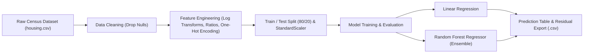

# 🏠 California Housing Price Prediction & Forecasting Engine

An applied machine learning and data engineering project built in **Python & Jupyter** that analyzes California demographic and geographic census data to forecast median residential home values (`median_house_value`).

---

## ⚡ Live In-Browser Execution (Zero Installation)

* 🚀 **[Launch Live in MyBinder (JupyterLab)](https://mybinder.org/v2/gh/BenjaminBanansos/housing-forecast-ml/main?labpath=Housing_forecast.ipynb)** — Spins up a temporary cloud sandbox with all libraries pre-installed so anyone can run the notebook in their browser.
* ⚡ **[Open in Google Colab](https://colab.research.google.com/github/BenjaminBanansos/housing-forecast-ml/blob/main/Housing_forecast.ipynb)** — One-click interactive cloud notebook execution on Google servers.

---

## 📌 Executive Summary

Predicting housing prices requires transforming highly skewed real-world distributions and accounting for multi-collinear geographic factors (such as proximity to the ocean and room-to-bedroom densities). This project implements an end-to-end predictive pipeline:

1. **Exploratory Data Analysis (EDA):** Discovered distribution skews and correlation patterns between geographic coordinates, income brackets, and property values.
2. **Feature Engineering:** Log-normal transformations, ratio formulations (`bedroom_ratio = total_bedrooms / total_rooms`), and one-hot encoding for categorical ocean proximity markers.
3. **Data Preprocessing:** Handled missing values, engineered interaction terms, and scaled feature matrices using `StandardScaler`.
4. **Machine Learning Benchmarking:** Trained and evaluated **Linear Regression** against an ensemble **Random Forest Regressor**.
5. **Automated Export:** Serialized test predictions to CSV (`prediction_table.csv`) for downstream analytics and business intelligence consumption.

---

## 🔬 Pipeline Architecture

---

## 📦 Tech Stack & Dependencies

* **Language:** Python 3.9+
* **Data Processing & Math:** `pandas`, `numpy`
* **Machine Learning:** `scikit-learn` (`LinearRegression`, `RandomForestRegressor`, `StandardScaler`, `train_test_split`)
* **Visualization:** `matplotlib`, `seaborn`, `plotly.express`
* **Interactive Environments:** MyBinder (JupyterLab), Google Colab, Jupyter Notebook

---

## 👤 Author

**Benjamin Banansos**  
*Solutions Architect & Technical Product Owner*  
* Toronto, ON, Canada  
* **Email:** [benjaminbanansos@gmail.com](mailto:benjaminbanansos@gmail.com)  
* **Interactive Portfolio:** [https://benjaminbanansos.github.io/portfolio/](https://benjaminbanansos.github.io/portfolio/)  
* **GitHub:** [@BenjaminBanansos](https://github.com/BenjaminBanansos)
